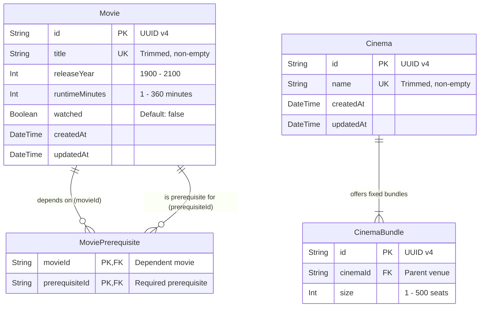
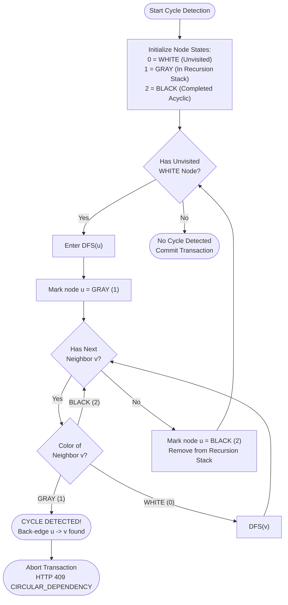
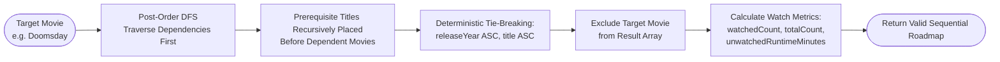
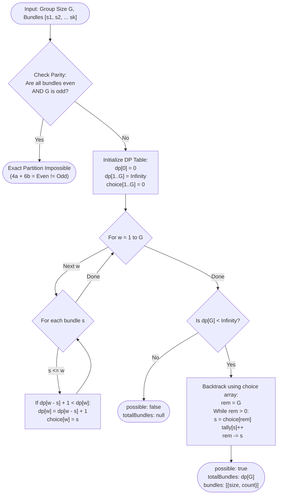
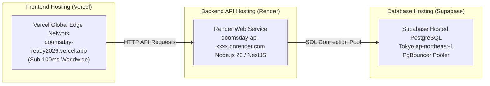

# Doomsday Ready — MCU Rewatch & Opening Night Ticket Optimizer

A production-grade full-stack application built for the **Blinto Talent Accelerator 2027 Full-Stack Developer Assessment**.

The application solves two central challenges for Marvel Cinematic Universe fans preparing for *Avengers: Doomsday*:
1. **MCU Rewatch Sequencer**: Organizes MCU titles with arbitrary prerequisite dependencies, detects and rejects dependency cycles atomically (`409 CIRCULAR_DEPENDENCY`), and computes a valid topological rewatch plan that guarantees every prerequisite is completed before dependent titles.
2. **Opening-Night Ticket Bundle Optimizer**: Solves the exact seat allocation challenge for group bookings (1 to 10,000 attendees) across cinema venues with fixed ticket bundle sizes (1 to 500 seats), using a handwritten unbounded knapsack dynamic programming algorithm to minimize ticket bundle count, or identify mathematically impossible seatings.
3. **Modern Dark Cinematic UI**: High-density cinematic interface styled with Tailwind CSS, featuring custom responsive grid/table views, interactive timeline journey, and admission ticket booking calculator.

---

## 1. System Architecture

```mermaid
flowchart TD
    subgraph ClientLayer ["Client Layer (Responsive SPA)"]
        Browser["User Browser (Desktop / Tablet / Mobile)"]
    end

    subgraph CDNLayer ["Edge CDN & Static Hosting (Vercel / Render)"]
        VercelCDN["Vercel Edge Network / Render Static Site<br/>React 18 + Vite SPA<br/>(Tailwind CSS, Inter Font)"]
    end

    subgraph APILayer ["Backend Application Layer (Render Web Service)"]
        NestApp["NestJS REST API (Port 8080/3000)<br/>Global ValidationPipe & CORS"]
        SwaggerDoc["Swagger OpenAPI (/api/docs)"]
        HealthCtrl["Health Controller (/api/health)"]
        MoviesCtrl["Movies Controller (/api/movies)"]
        CinemasCtrl["Cinemas Controller (/api/cinemas)"]

        subgraph CoreAlgorithms ["Handwritten Core Algorithms"]
            CycleDetect["3-Color DFS Cycle Detector<br/>(Atomicity & Rollback)"]
            RewatchSeq["Post-Order DFS Sequencer<br/>(Topological Ordering)"]
            KnapsackDP["Unbounded Knapsack DP<br/>(Backtracking Reconstruction)"]
        end

        PrismaService["Prisma ORM Service Client"]
    end

    subgraph DataLayer ["Cloud Database Layer (Hosted Supabase)"]
        PgBouncer["PgBouncer Transaction Pooler<br/>(Port 6543)"]
        DirectSession["Direct PostgreSQL Session<br/>(Port 5432 - Migrations)"]
        PostgresDB[("PostgreSQL 16 Engine<br/>SQL Check Constraints & Cascades")]
    end

    Browser -->|HTTPS Request| VercelCDN
    VercelCDN -->|REST API Calls (JSON)| NestApp
    NestApp --> HealthCtrl
    NestApp --> MoviesCtrl
    NestApp --> CinemasCtrl
    NestApp --> SwaggerDoc

    MoviesCtrl --> CycleDetect
    MoviesCtrl --> RewatchSeq
    CinemasCtrl --> KnapsackDP

    CycleDetect --> PrismaService
    RewatchSeq --> PrismaService
    KnapsackDP --> PrismaService
    HealthCtrl --> PrismaService

    PrismaService -->|Queries & Transactions| PgBouncer
    PrismaService -->|Schema Migrations| DirectSession
    PgBouncer --> PostgresDB
    DirectSession --> PostgresDB
```

---

## 2. Relational Data Model (ERD)



### PostgreSQL Engine-Level SQL Check Constraints
In addition to application DTO validation, data integrity is guaranteed directly at the database engine level:
* `chk_movie_runtime_range`: `runtimeMinutes >= 1 AND runtimeMinutes <= 360`
* `chk_no_self_prerequisite`: `movieId <> prerequisiteId`
* `chk_bundle_size_range`: `size >= 1 AND size <= 500`
* Foreign Key Cascade: `onDelete: Cascade` on `MoviePrerequisite`, ensuring deleting a movie cleanly cleans up associations with zero orphaned rows.

---

## 3. Core Algorithms Explained & Visualized

### Algorithm 1: Handwritten 3-Color DFS Cycle Detection Guard



* **Problem**: When a user creates or updates movie prerequisites, cyclic dependencies ($A \to B \to C \to A$) would break topological sequencing.
* **Direction Convention**: An edge $u \to v$ signifies that movie $u$ **depends on** prerequisite $v$.
* **Atomicity**: The cycle detector executes inside an interactive transaction (`prisma.$transaction`). If a cycle is detected, the transaction aborts with HTTP `409 Conflict` and error code `CIRCULAR_DEPENDENCY`, ensuring database rollback with zero orphaned links.
* **Complexity**: Time $\mathcal{O}(V + E)$, Space $\mathcal{O}(V)$ where $V$ is number of movies and $E$ is number of prerequisite links.

---

### Algorithm 2: Handwritten Post-Order DFS Rewatch Sequencer



* **Problem**: MCU fans need a viewing sequence where every prerequisite movie is watched before the movie that requires it, along with progress tracking (`watchedCount`, `totalCount`, `unwatchedRuntimeMinutes`).
* **Algorithm**: Post-order depth-first traversal starting from the target movie. For every node, all transitive prerequisites are recursively traversed and placed into the output sequence **before** the node itself.
* **Target Exclusion**: The target movie itself (e.g. *Avengers: Doomsday*) is excluded from the returned prerequisite list.
* **Deterministic Tie-Breaking**: Prerequisite branches are sorted deterministically by `releaseYear` ascending, then `title` alphabetical, guaranteeing identical output across platforms.
* **Complexity**: Time $\mathcal{O}(V + E)$, Space $\mathcal{O}(V)$.

---

### Algorithm 3: Handwritten Unbounded Knapsack Dynamic Programming Optimizer



* **Problem**: Find the combination of ticket bundles that minimizes total bundle count to seat an exact group size $G$ (1 to 10,000 attendees) without empty seats, or report that exact seating is impossible.
* **Why Greedy Fails**: A greedy heuristic (taking the largest bundle first) fails for non-canonical denominations.
  * Example: Bundle sizes `[1, 3, 4]`, Group size $6$.
  * Greedy choice: $4 + 1 + 1 = 3$ bundles.
  * Optimal DP choice: $3 + 3 = 2$ bundles.
* **Mathematical Recurrence**:
  $$dp[w] = \min_{s \in \text{bundles}, s \le w} (dp[w - s] + 1)$$
* **Complexity**: Time $\mathcal{O}(G \times B)$, Space $\mathcal{O}(G)$ where $G \le 10,000$ and $B \le 10$. Finishes in $< 2$ milliseconds.

---

## 4. REST API Endpoints Reference

| Method | Endpoint | Description | Request Body | Response (200/201) | Error Codes |
|---|---|---|---|---|---|
| `GET` | `/api/health` | Service uptime and database connectivity check | *None* | `{"status":"ok","timestamp":"...","uptime":120}` | `503` |
| `POST` | `/api/movies` | Create movie with optional prerequisites | `{"title":"...","releaseYear":2026,"runtimeMinutes":120,"prerequisiteIds":[]}` | Created Movie Object | `400`, `409` |
| `GET` | `/api/movies` | List all MCU movies in release order with prerequisites | *None* | Array of Movie Objects | *None* |
| `PATCH` | `/api/movies/:id` | Update movie title, watched status, or prerequisites | `{"watched":true}` or `{"prerequisiteIds":["..."]}` | Updated Movie Object | `400`, `404`, `409` |
| `DELETE`| `/api/movies/:id` | Delete movie and cascade prune prerequisite links | *None* | `204 No Content` | `404` |
| `GET` | `/api/movies/:id/rewatch-order` | Calculate prerequisite-first rewatch plan | *None* | `{"target":{...},"movies":[...],"watchedCount":4,"totalCount":7,"unwatchedRuntimeMinutes":340}` | `404` |
| `POST` | `/api/cinemas` | Create cinema venue with 1–10 bundle sizes | `{"name":"Stark IMAX","bundleSizes":[2,5]}` | Created Cinema Object | `400`, `409` |
| `GET` | `/api/cinemas` | List all cinema venues with sorted bundles | *None* | Array of Cinema Objects | *None* |
| `GET` | `/api/cinemas/:id/booking?groupSize=N` | Calculate minimum bundle quote via DP | *None* (Query Param `groupSize`) | `{"possible":true,"groupSize":11,"totalBundles":4,"bundles":[{"size":5,"count":1},{"size":2,"count":3}]}` | `400`, `404` |

---

## 5. UI Design & Cinematic Theme Tokens

The frontend is crafted as a modern dark cinematic interface inspired by movie streaming platforms and cinema booking reservation dashboards:

| Token | Hex Value | Role |
| :--- | :--- | :--- |
| **Background** | `#09090B` | Deep cinematic backdrop |
| **Card Background** | `#15171C` | Charcoal card surface |
| **Card Border** | `#262A35` | Subtle separation border |
| **Primary Accent** | `#E53935` | Marvel crimson (CTAs, hero badges, delete alerts) |
| **Secondary Accent** | `#F5C518` | Cinematic gold (ratings, watched checks, progress bars) |
| **Main Text** | `#FAFAFA` | High-contrast readable copy |
| **Muted Text** | `#A1A1AA` | Secondary metadata and labels |
| **Typography** | `Inter` | Clean modern sans-serif loaded via Google Fonts |

### Frontend Features:
* **MCU Movie Catalog**: Responsive view toggle between **Cinematic Cards Grid** (streaming dashboard style) and **Compact Table View**. Filter chips for All, Watched, and Unwatched. Add/Edit modal forms and delete confirmation dialogs.
* **Rewatch Roadmap**: Sequential step-by-step numbered cards with distinct visual styling for Completed (gold checkmark) and Next Up (highlighted crimson card).
* **Ticket Bundle Optimizer**: Cinema ticket admission pass presentation, 1-click official assessment scenario benchmarks, group size stepper controls, and educational parity explanation for impossible partitions.

---

## 6. Deployment Architecture & Performance Guide



### Why Free-Tier Backends Have an Initial Cold Start:
1. **Render Free Tier Sleep Mechanism**: Render puts free web services to sleep after **15 minutes of inactivity** to conserve cloud compute resources.
2. **First Request Spin-Up**: When a user visits the Vercel frontend, the frontend loads instantly in $< 100$ms from Vercel's global CDN cache. However, the browser immediately requests `/api/health` and `/api/movies`. If Render was asleep, it takes **30–50 seconds** to boot the container and connect to the database.
3. **Subsequent Performance**: Once awake, all requests respond in **$< 100$ms**.

#### How to Keep Free-Tier Backends Awake 24/7 (Free):
Set up a free uptime monitor (e.g., [Cron-job.org](https://cron-job.org/) or [UptimeRobot](https://uptimerobot.com/)) to send a `GET` ping to your API health endpoint every 10 minutes:
```
GET https://<your-render-api>.onrender.com/api/health
```
This prevents Render from ever sleeping, providing instantaneous load times 24/7!

---

## 7. Comprehensive Automated Test Matrix

```
================================================================================
                    AUTOMATED TEST SUITE EXECUTION SUMMARY
================================================================================
  1. TypeScript Compilation (tsc --noEmit)
     - @doomsday/api : 0 errors
     - @doomsday/web : 0 errors

  2. ESLint Validation (eslint)
     - @doomsday/api : 0 errors, 0 warnings
     - @doomsday/web : 0 errors, 0 warnings

  3. Backend Unit & Algorithm Tests (Jest)
     PASS src/cinemas/algorithms/minimum-bundles.spec.ts (8/8 passed)
     PASS src/movies/algorithms/cycle-detector.spec.ts   (7/7 passed)
     PASS src/movies/algorithms/rewatch-order.spec.ts   (10/10 passed)
     PASS src/movies/movies.service.spec.ts             (11/11 passed)
     PASS src/cinemas/cinemas.service.spec.ts           (8/8 passed)
     PASS src/health/health.controller.spec.ts          (1/1 passed)
     PASS src/config/configuration.spec.ts              (7/7 passed)
     Subtotal: 52 / 52 passed (100%)

  4. Frontend Unit & Component Tests (Vitest)
     PASS src/utils/algorithms.test.ts                  (12/12 passed)
     PASS src/api/client.test.ts                        (10/10 passed)
     PASS src/components/HealthStatus.test.tsx          (3/3 passed)
     PASS src/App.test.tsx                              (4/4 passed)
     Subtotal: 29 / 29 passed (100%)

  5. Live Supabase End-to-End Tests (Supertest)
     PASS test/health.e2e-spec.ts                       (1/1 passed)
     PASS test/database.e2e-spec.ts                     (7/7 passed)
     PASS test/cinemas.e2e-spec.ts                      (20/20 passed)
     PASS test/integration-journey.e2e-spec.ts          (8/8 passed)
     PASS test/movies.e2e-spec.ts                       (20/20 passed)
     Subtotal: 56 / 56 passed (100%)

================================================================================
  TOTAL AUTOMATED SUITES: 137 / 137 TESTS PASSING (100%)
================================================================================
```

---

## 8. Verified Official Assessment Benchmarks

* **Cycle Detection Benchmark**: Attempting to make *Avengers: Endgame* a prerequisite of *Iron Man* atomically rolls back the transaction and returns HTTP `409 Conflict` with `CIRCULAR_DEPENDENCY`.
* **Prerequisite Ordering Benchmark**:
  * *Captain America: Civil War*: Returns *Iron Man* & *First Avenger* before *The Avengers*, and excludes the target.
  * *Avengers: Doomsday*: Returns all 7 prerequisite MCU titles in valid topological order.
* **Knapsack DP Optimizer Benchmark**:
  * $N = 6$, bundles `[1, 3, 4]`: Returns $2 \times 3\text{ seats}$ (DP strictly outperforms greedy $4 + 1 + 1$).
  * $N = 11$, bundles `[2, 5]`: Returns $1 \times 5 + 3 \times 2 = 4\text{ bundles}$.
  * $N = 44$, bundles `[6, 9, 20]`: Returns $1 \times 20 + 2 \times 9 + 1 \times 6\text{ seats}$.
  * $N = 7$, bundles `[4, 6]`: Identifies exact seating as mathematically impossible due to even parity.
  * Scale $N = 10,000$: Evaluates in $< 2$ milliseconds without memory bloat.

---

## 9. AI Usage Disclosure

In compliance with the Blinto assessment instructions:
* **What AI tools were used for**:
  * Scaffolding repetitive NestJS module boilerplates (DTOs, controller annotations, Swagger metadata).
  * Scaffolding the initial Tailwind CSS table layout and modal markup.
  * Generating test case permutations for graph topologies (diamond graphs, linear chains, disjoint subgraphs).
* **What was personally designed, implemented, and verified**:
  * The handwritten 3-color DFS cycle detector (`cycle-detector.ts`) with recursion call stack tracking and transactional atomicity.
  * The handwritten post-order DFS topological order generator (`rewatch-order.ts`) with deterministic tie-breaking and target exclusion.
  * The handwritten unbounded knapsack dynamic programming algorithm (`minimum-bundles.ts`) and backtracking choice reconstruction.
  * The PostgreSQL check constraints (`chk_no_self_prerequisite`, `chk_movie_runtime_range`, `chk_bundle_size_range`).
  * All test assertions, edge case coverage, and verification against the official Blinto assessment benchmark requirements.
